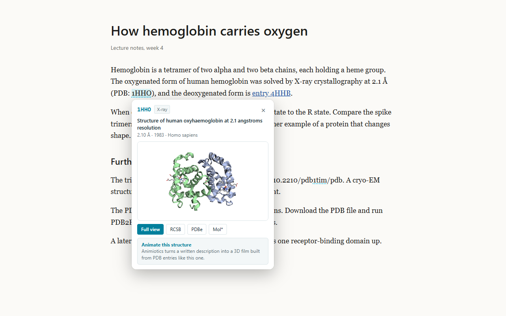

# PDB Peek

Hover a PDB ID in a paper, on Wikipedia or on a lab page and see the structure in 3D, with its experimental method, resolution, organism and primary citation. Free and open source.



## What it does

- Finds PDB IDs written in text ("PDB: 1HHO", "PDB IDs 6VXX, 6VYB and 6VSB", "doi:10.2210/pdb1tim/pdb") and links to RCSB, PDBe, PDBj, NCBI Structure and Mol*.
- Shows a preview card on hover: title, method, resolution, release year, organism and a spinning 3D model.
- Full view with cartoon, stick and sphere styles, chain and ligand lists, the citation with its DOI plus PNG export.
- Search by PDB ID or protein name from the toolbar button.
- Select any text, right-click and choose "Peek at PDB entry" to open it directly.

By default it runs on Wikipedia, PubMed, PMC, Europe PMC, RCSB, EBI, UniProt, bioRxiv, medRxiv, Proteopedia and the main journal sites. Turn on "Work on every website" in the popup to use it anywhere; Chrome asks for that permission separately.

## Privacy

PDB Peek collects nothing. It has no analytics and no account. To show an entry it requests that entry's metadata and coordinates from the RCSB Protein Data Bank (data.rcsb.org, models.rcsb.org, search.rcsb.org). Your settings stay in Chrome sync storage. Full policy: [docs/privacy.html](docs/privacy.html).

## Install from source

1. Download this repository.
2. Open `chrome://extensions`, turn on Developer mode and choose "Load unpacked".
3. Select the `extension` folder.

## Test

```bash
npm install @playwright/test
npx playwright install chromium
node test/smoke.mjs
```

The smoke test loads the extension in Chromium, checks ID detection (and that years such as "PDB 2023" are ignored), the hover card, the full view, the popup search, the on/off setting and a live Wikipedia page.

## Credits

- Structures and metadata: [RCSB Protein Data Bank](https://www.rcsb.org/) (Burley et al., Nucleic Acids Research 2023). PDB data is available under CC0.
- 3D rendering: [3Dmol.js](https://3dmol.org/) 2.5.5, BSD-3-Clause (Rego and Koes, Bioinformatics 2015). License in `extension/vendor/3Dmol-LICENSE.txt`.

Made by [Animiotics](https://animiotics.com/?utm_source=github&utm_medium=referral&utm_campaign=pdb_peek), which turns a written description into a 3D scientific animation built from PDB structures.

## License

MIT
